# Thermomine

**An aquarium decoration that tells you the water temperature from across the room.**

Thermomine is a 3D-printed naval mine that sits on the gravel of your tank. A sealed LED inside glows **blue** when the water is too cold, **green** when it's just right, and **red** when it's too warm. There's no display to squint at and no app: one look at the tank is enough.

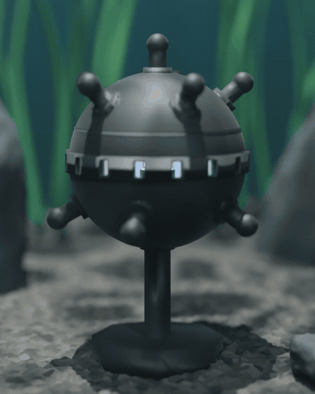

> Product renders (Blender, Cycles). The product hasn't been photographed yet.

## How it works

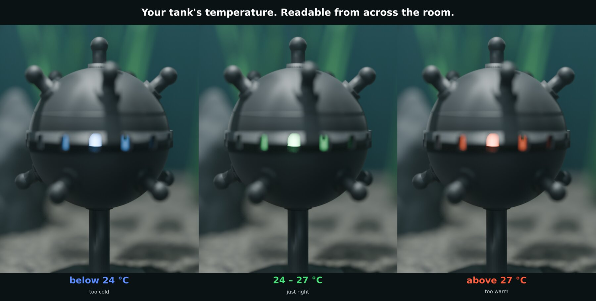

| Glow | Water temperature (default range) | Meaning |
|---|---|---|
| 🔵 Blue | below 24 °C | too cold: check the heater |
| 🟢 Green | 24–27 °C | just right (tropical community tank) |
| 🔴 Red | above 27 °C | too warm: check for overheating |
| 🟣 Blinking purple | — | temperature probe not connected |

The colour fades smoothly over 1.5 °C at each limit. You can change the range in the firmware (`TEMP_LOW`, `TEMP_HIGH`).

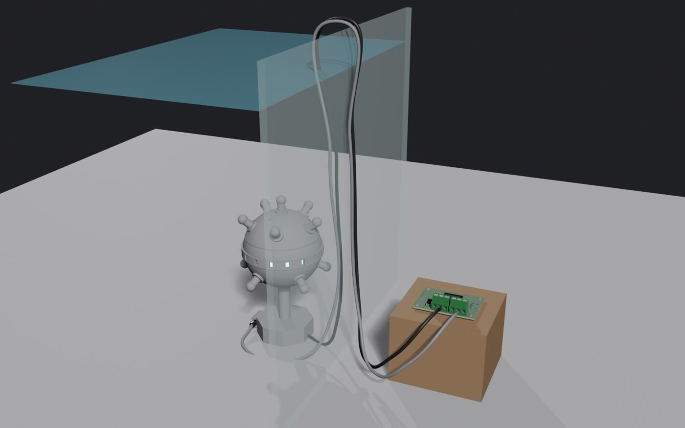

- A stainless **DS18B20 probe** clips into the mine's base and measures the water.
- A sealed **WS2811 12 mm bullet pixel** (IP68) sits in a pocket inside the mine. Its light shines out through 16 slots in the band.
- The **controller board** stays dry outside the tank and is powered over USB-C.
- Both cables run over the tank rim with a drip loop, so water running down the cables drips off before it reaches the board.

## The mine

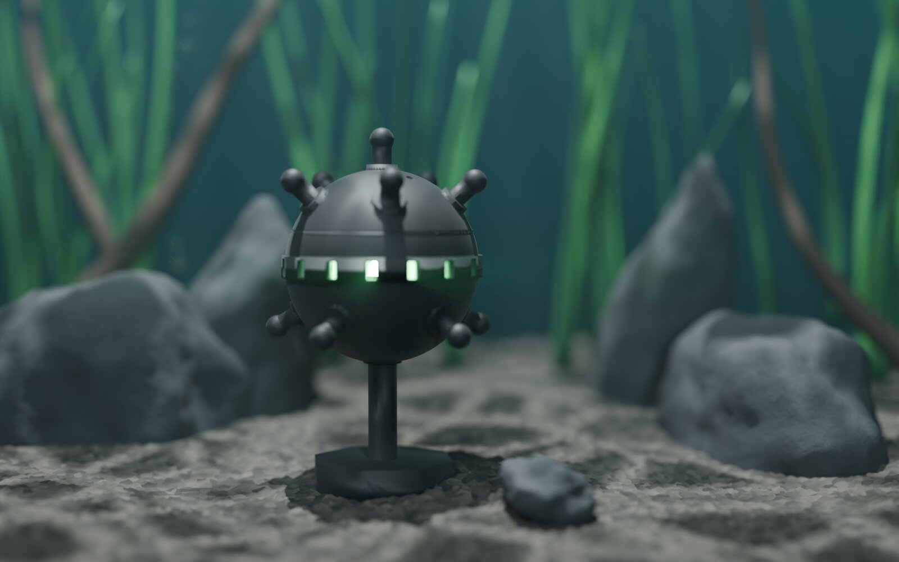

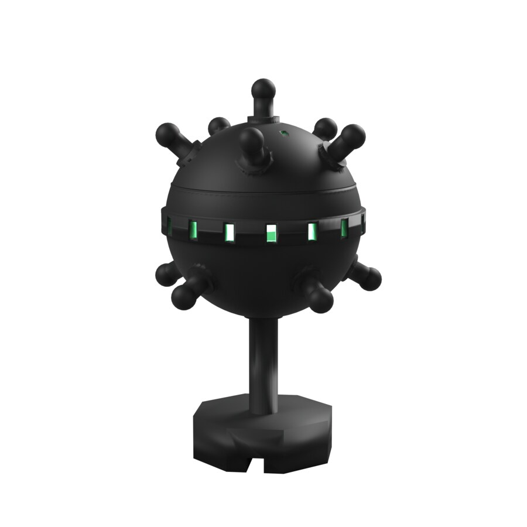

- **Size:** 155 mm tall, sphere Ø 80 mm, for 60–200 L tanks
- **Material:** MJF-printed PA12 nylon, black-dyed outside. A light-coloured interior reflects the LED and makes the glow brighter.
- **Two parts:** the bottom (base, tether, lower shell with glow slots) and the cap (top shell with horns)
- **Bayonet cap:** drop it on and turn it 30° clockwise until it clicks. It opens without tools for cleaning.
- **Flooded by design:** water fills the shell through the slots, and air escapes through 4 vents. Only the factory-sealed LED and probe get wet, so nothing printed has to be watertight.
- **Hollow base:** you fill it with sand for weight and seal it with aquarium silicone. That saves about 30 % of the print material.

 

| Inside: cable bore, LED pocket, glow slots | Hollow base for sand | Bayonet cap (open) |
|---|---|---|
| 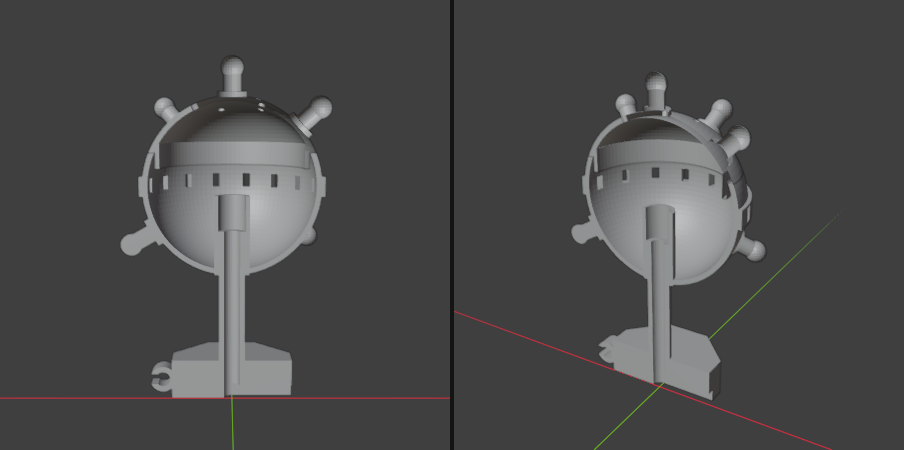 | 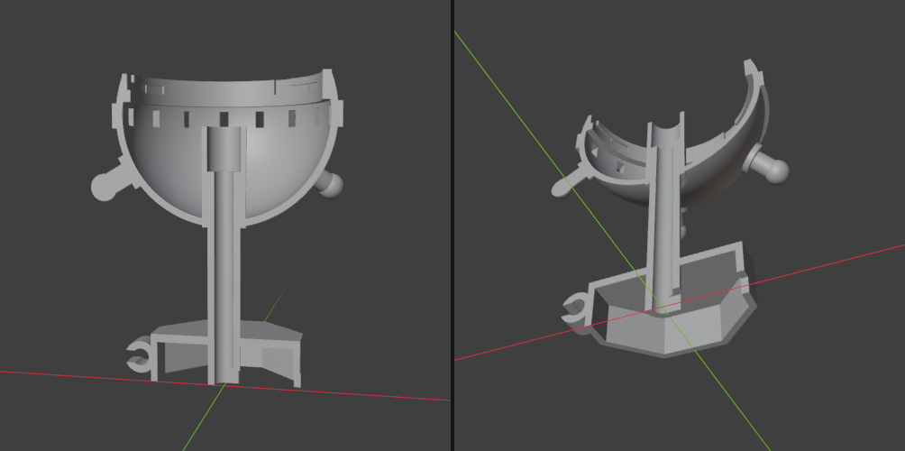 | 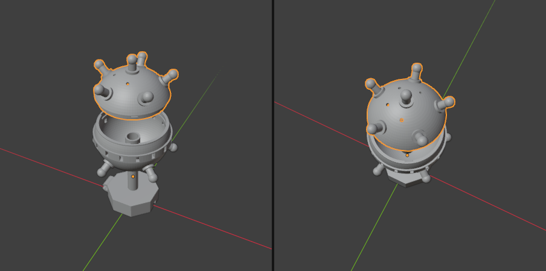 |

## The controller board

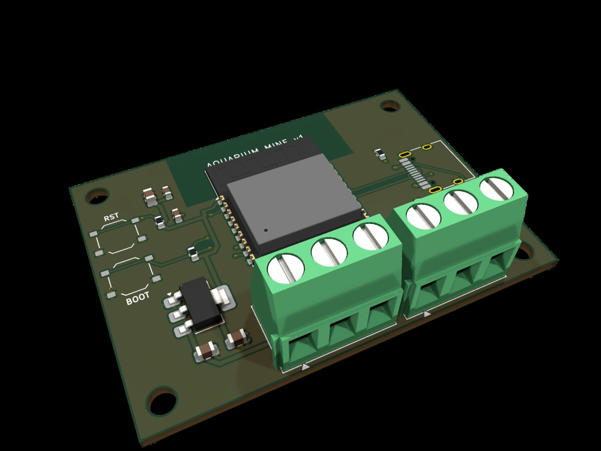

- 58 × 42 mm, 2 layers, **designed for JLCPCB assembly**, so no soldering is needed
- **ESP32-C3-WROOM-02** with native USB, so USB-C goes straight to the chip with no USB-serial chip
- **AMS1117-3.3** regulator and a **74AHCT1G125** level shifter, which brings the LED data line to 5 V
- Two 5.08 mm **screw terminals:** LED (+5V / DIN / GND) and probe (GND / DQ / 3V3)
- **RESET** and **BOOT** buttons, and 4 × M3 mounting holes
- Generated in code with `pcb/build_board.py` (KiCad 10 + freerouting). The KiCad design-rule check passes with 0 errors.

 

## Getting one built

**1. Print the mine.** Upload [`print/mine_print_plate.3mf`](print/mine_print_plate.3mf) to an MJF print service (JLC3DP, Craftcloud, Sculpteo and so on) and choose PA12, black-dyed. STEP and STL versions are in the same folder. For assembly, sand filling and wiring, see [`print/README.md`](print/README.md).

**2. Order the board.** In [`pcb/fab/`](pcb/fab/) you'll find the Gerber zip, the BOM (with LCSC part numbers) and the CPL (component placement list). Upload all three to JLCPCB with PCB Assembly turned on. In their preview, check the rotation of U1, J1, U2 and U3, and confirm that part C474882 is the 3-pin terminal.

**3. Flash the firmware.** Open [`firmware/aquarium_mine_temp/aquarium_mine_temp.ino`](firmware/aquarium_mine_temp/aquarium_mine_temp.ino) in the Arduino IDE. Select "ESP32C3 Dev Module" and turn on "USB CDC On Boot". Install the OneWire, DallasTemperature and Adafruit NeoPixel libraries. For the first upload, hold BOOT while pressing RESET.

**Workshop drawings:** A3 part drawings to SN EN ISO conventions (first-angle projection, ISO 128 line types, ISO 129-1 dimensioning, ISO 2768-m). Click a preview to open the PDF:

| TM-001-01 Bottom part | TM-001-02 Cap |
|---|---|
| [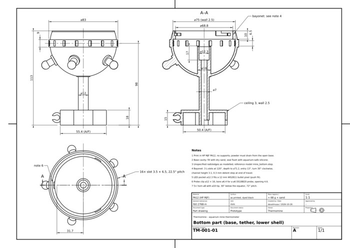](print/drawings/Thermomine_TM-001-01_bottom.pdf) | [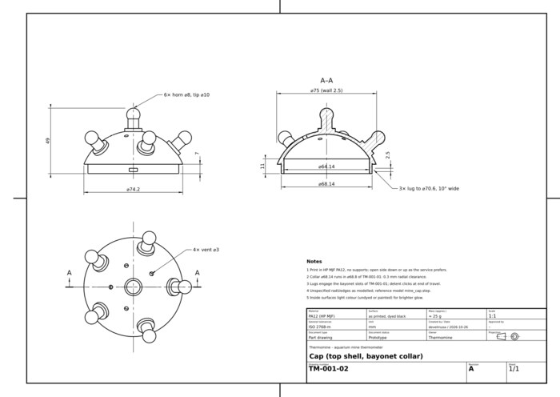](print/drawings/Thermomine_TM-001-02_cap.pdf) |

**Parts to buy:** a 5 V WS2811 12 mm IP68 bullet pixel, a waterproof DS18B20 probe, a USB-C power supply and aquarium-safe silicone.

## Repository layout

| Folder | Contents |
|---|---|
| [`print/`](print/) | Print files (3MF, STEP, STL), the FreeCAD build scripts (`build_step.py`, `export_3mf.py`) and the assembly guide |
| [`pcb/`](pcb/) | KiCad board, generator script, fab files, 3D previews |
| [`firmware/`](firmware/) | Arduino sketch |
| [`marketing/`](marketing/) | Blender scenes, render scripts, product shots, TikTok concepts and clips |
| [`docs/images/`](docs/images/) | The images in this README |

## Marketing material

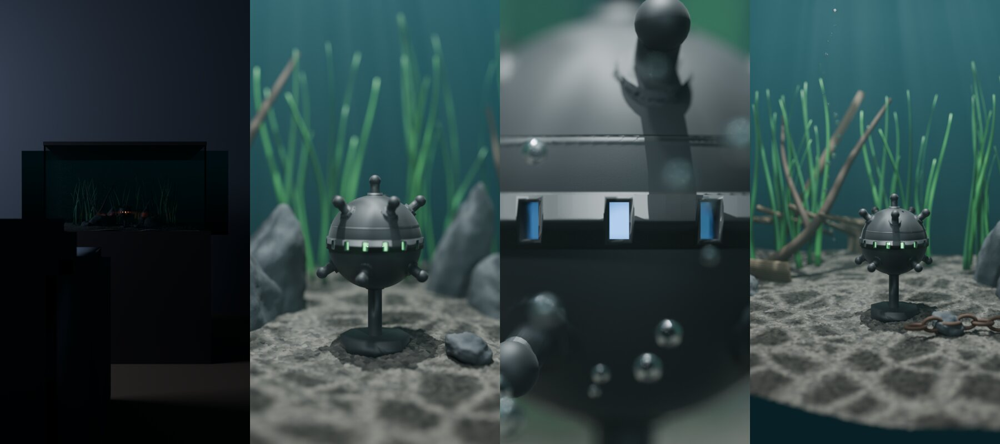

Concept first frames for TikTok, rendered in Blender with the exact print model, as bases for AI-generated video (MiniMax Hailuo). The target audience, positioning and listing copy are in [`marketing/README.md`](marketing/README.md).

## Status

This is a **prototype design**. Nothing has been built or tested yet:

- **Board and firmware:** designed and checked against the design rules, but not yet manufactured or run on hardware.
- **Print:** the files are valid, closed solids, but no part has been printed yet. Fit tolerances (0.3 mm bayonet clearance) may need adjusting after the first print.
- **Images:** all are renders, not photos. The glow brightness assumes a light-coloured interior.
- **Aquarium safety:** PA12 is generally considered inert in water but isn't certified for aquariums. Soak and rinse the parts before use.
- **Selling it:** in the EU this needs at least CE marking (EMC, RoHS). The ESP32 also brings the radio equipment rules into play, plus WEEE/ElektroG registration, LUCID packaging registration and the product safety regulation (GPSR). A version without a radio chip would make this simpler.

No license has been chosen yet.
